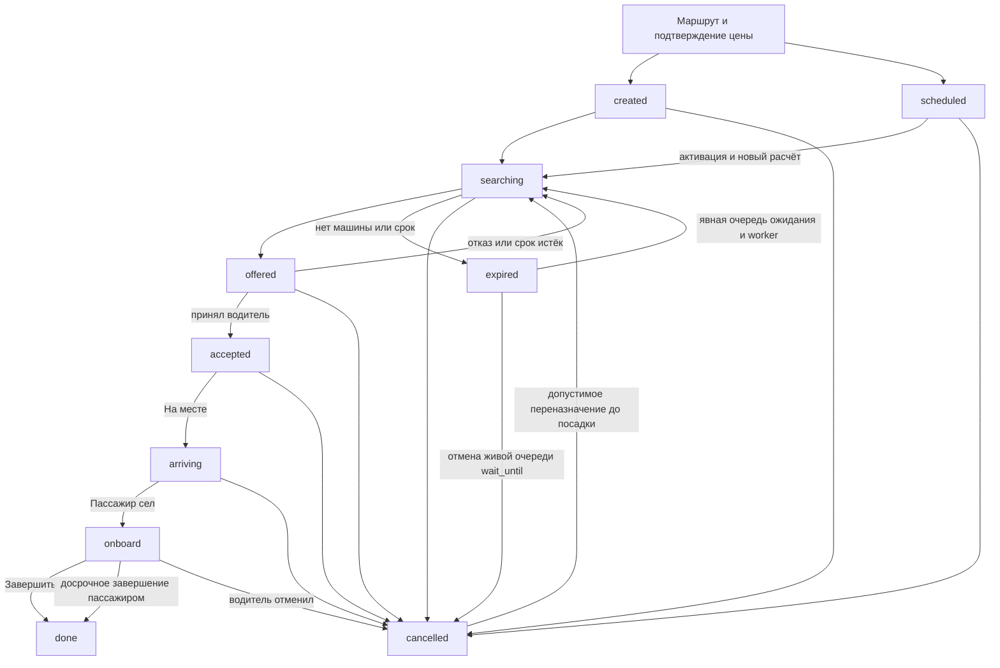

# Источники, состояния и договоры такси

[Индекс](00-index.md) · [Сценарии](02-user-scenarios.md) · [Расхождения](03-findings-and-acceptance.md)

## Источники и применение replica/REA

Прочитаны и применены `replica-recon`, `replica-test`, `replica-diff` из
[replica-skill](https://github.com/Jakeschincariol/replica-skill/tree/77c9436fb3d18c3d58169efb8caf4fe906b0dc51)
на SHA `77c9436fb3d18c3d58169efb8caf4fe906b0dc51`: источник → экран → цель → исключения → разница с кодом → проверка.
Шаблон размещения адаптирован к существующим `docs/plans/`, без создания второго статусного реестра.
Запрет recon на получение чужого кода соблюдён: конкуренты исследуются по открытой справке; REA применяется
отдельно к **собственному** собранному PWA Юлдаша. Инструменты `parity.py`/`imgdiff.py` не запускались:
нет равных состояний двух приложений и оснований для процента сходства. Чтение методики не названо запуском утилиты.

В списке MCP-инструментов и свежей среде исходно replica/REA/JADX не найдены. Установка из прошлой сессии
не переносится автоматически. Replica загружен в отдельную папку; REA собран и запущен локально вне
репозиториев продукта. Версия форка FreeNAP/rea-- — **5.0.0**, source SHA
`1d13cef5f46f5e07f594bde7b1a4725f189b9a5e`, а не упоминавшаяся ранее установка другого upstream 6.8.0.
Подробный фактический результат REA, параметры и пределы — в [протоколе](04-validation-and-handoff.md).
APK/JADX/Ghidra и анализ установленного конкурента **не выполнялись**; APK в этой свежей среде отсутствует.
Обход доступа, смена системных защит и чужие секреты не нужны для этого исследования.

### Официальные публичные ориентиры

Проверка 05.11.2026. Яндекс Про — регион **Москва**, Go — RU, обучающие Android/iOS материалы.
Это ограниченное чтение открытых страниц; частные экраны/ошибки/последний APK не наблюдались.

| ID | Источник | Наблюдение, полезное для сценариев | Ограничение переноса |
|---|---|---|---|
| Y01 | [Go Android / TalkBack](https://inclusion.yandex.ru/tutorials/go-android) | Адрес, точка посадки, тариф/цена/ETA/пожелания/оплата; машина и связь после назначения; ожидание, итог и оценка | Обучающая демонстрация, версия не указана; не доказательство всех current вариантов |
| Y02 | [Go iOS / VoiceOver](https://inclusion.yandex.ru/tutorials/go-ios) | Несколько точек и изменение цены, маршрут близкому, экстренный и обычный контакт, история | Демонстрация другой платформы; не факт реализации Юлдаша |
| Y03 | [Как работать в Про](https://pro.yandex.ru/ru-ru/moskva/knowledge-base/taxi/app/yandexpro-how-to) | Линия отдельно от текущего заказа; действия карточки зависят от стадии; выбор навигатора | Не переносить все механизмы кабинета и приоритетов |
| Y04 | [Ожидание](https://pro.yandex.ru/ru-ru/moskva/knowledge-base/taxi/app/waiting) | Подача и остановка в пути различаются; таймер прекращается при посадке/продолжении | Минуты, скорость, стоимость и условия конкурента не утверждены для Юлдаша |
| Y05 | [Отмена водителем](https://pro.yandex.ru/ru-ru/moskva/knowledge-base/taxi/app/cancel) | Неявка требует стадии прибытия, связи, корректной точки и причины | Радиус/минуты/санкции региональны и не назначаются нами |
| Y06 | [Отмена пассажиром](https://pro.yandex.ru/ru-ru/moskva/knowledge-base/taxi/popular-questions/order-canceled-by-user) | Последствия зависят от стадии, оплаты и исключений; виден итог | Это политика конкурента, не автоматическая санкция Юлдаша |
| Y07 | [Оплата поездки](https://pro.yandex.ru/ru-ru/moskva/knowledge-base/taxi/income-diff/order-types) | Водитель должен понимать, брать ли наличные; смена способа сопровождается сообщением | Корпоративная модель/парк/сроки не переносятся |
| Y08 | [Комиссии](https://pro.yandex.ru/ru-ru/moskva/knowledge-base/taxi/income-diff/comission) | Цена и разные комиссии раскрываются раздельно | Проценты старой московской статьи не являются экономикой Юлдаша |
| Y09 | [Непрошедшая оплата](https://pro.yandex.ru/ru-ru/moskva/knowledge-base/taxi/income-diff/instant-compensation) | Ожидание результата, компенсация и поздняя оплата требуют истории финансовых событий | Не обещать Юлдашу гарантированную компенсацию или срок |
| Y10 | [Не приходят заказы](https://pro.yandex.ru/ru-ru/moskva/knowledge-base/taxi/rides/net-zakazov) | Различаются нет спроса, связи, допуска и ограничение | Это основа диагностики, не наблюдение частного backend |
| Y11 | [Особые пожелания](https://pro.yandex.ru/ru-ru/moskva/knowledge-base/taxi/rides/special-options) | Потребность в текстовой связи/месте для кресла должна дойти до водителя | Юридические правила и возможность помощи проверяются отдельно |
| Y12 | [Поддержка](https://pro.yandex.ru/ru-ru/moskva/knowledge-base/taxi/advice/support) | Контекст заказа и запасной путь обращения | Не обещать SLA и круглосуточного диспетчера |

В таблице нет тарифных ставок: московская цена/комиссия/штраф не становятся решением владельца.
Обучающие изображения не копируются в приложение. Из Y01/Y02 не выводится, что все сценарии уже доступны
в текущем аккаунте/регионе конкурента. Неиспытанные loading/empty/error/offline конкурента — NOT_OBSERVED.

### Внутренние источники и старые ветки

- Текущие backend: `app/instant_service.py`, `app/routers/instant.py`, `app/taxi.py`, `app/taxi_worker.py`,
  `app/debt.py`, `app/price_freeze.py`, `app/routers/payments.py`, `app/routers/safety.py`, `app/routers/chat.py` по конкретной области.
- Android: `InstantOrderScreen.kt`, `TaxiTripScreen.kt`, `Taxi*Screen.kt`, `TaxiLineService.kt`, `data/InstantLocationSocket.kt`, `data/ApiClient.kt`.
- PWA: `InstantOrderScreen.tsx`, `InstantDriverTripScreen.tsx`, `Taxi*Screen.tsx`, `api/instant.ts`, общий auth и feature gate.
- [Исторический июльский UI-план](../../taxi-courier-ui-redesign-2026-07.md),
  [premium](../../taxi-courier-premium-2026-07-30.md), [классы](../../taxi-classes-2026-08.md),
  [старый аудит](../../audit-2026-08-07-w1-02-taxi.md), [роли](../../audit-role-journeys.md),
  [восстановление](../../audit-taxi-courier-recovery-2026-09-19.md), [оценка](../../audit-taxi-rating-recovery-2026-09-19.md).
  Исторический дефект не считается текущим без новой сверки; старый PASS не переносится на новый SHA.
- Снимок прежнего исследования конкурентов: `research/app-audit-snapshot` =
  `c5be55a7f29efbde2ed537700ed254d3839dcdf1`, `docs/research/apps/README.md`.
  Это faithful export прошлых документов, не полный APK/runtime-аудит; новые доказательства из него не выдумываются.
- Сверены актуальные remote refs: `agent/taxi-courier-ui-redesign` e7d83d0e;
  `claude/taxi-courier-integration-test-72e3f5` dd966f90; `codex/wave1-taxi-offline-20261014` e0c1ad45;
  `feat/taxi2-base` 3bbc9c4f; `feat/taxi-gate` 88f9d5db; `feat/taxi-money-rules` c438c896;
  `feat/taxi-polish` dd961790; `feat/taxi-polish-2` 765c1f88;
  `feature/taxi-courier-premium` a554ce67; `release-taxi` 71a8075f.
  Это разведка имён/вершин, **не** построчное ревью или исполнение каждой ветки. Приоритет доказательств — закреплённый main.

## Граф заказа: код отдельно от интерфейса

КОД: [enum](https://github.com/bairasbai/yuldash/blob/1b02947b56aa279f7721f475d26c0dd8018cda75/backend/app/models.py#L870),
[переходы и права](https://github.com/bairasbai/yuldash/blob/1b02947b56aa279f7721f475d26c0dd8018cda75/backend/app/instant_service.py#L55),
[endpoint прибытия/посадки](https://github.com/bairasbai/yuldash/blob/1b02947b56aa279f7721f475d26c0dd8018cda75/backend/app/routers/instant.py#L831).

Это граф **существующих** статусов и существенных исключений, не новая серверная схема.
`accepted` для человека — «водитель едет к тебе»; `arriving` после POST `/arrived` — «водитель на месте».
Комментарий enum называет arriving подачей; подписи и тесты следует сверять с обработчиком перехода.
`onboard` — человек в машине. Статусы не доказывают физическое действие без требуемого подтверждения.

Исключения нельзя стереть общим правилом «terminal навсегда»:

- `expired + wait_until` может быть живой очередью «подожду». Worker возвращает её в поиск;
  отмена должна снять `wait_until`. [Код](https://github.com/bairasbai/yuldash/blob/1b02947b56aa279f7721f475d26c0dd8018cda75/backend/app/taxi_worker.py#L153).
- После определённой отмены водителя до посадки сервис может переназначить **тот же** заказ;
  его отмена/перезапуск являются внутренним составным действием.
  [Код](https://github.com/bairasbai/yuldash/blob/1b02947b56aa279f7721f475d26c0dd8018cda75/backend/app/instant_service.py#L2795).
- Окончательно завершённый/отменённый без такого договора заказ не должен воскресать от позднего ответа,
  старого offer или worker. Повторная поездка — новое явное действие; повтор транспорта — прежнее намерение.

Дополнительные состояния, которые не следует сплющивать в enum заказа:

| Ось | Состав целевого покрытия |
|---|---|
| Доступность | загрузка flags/availability, разрешён, master off, city/class off, нет машин, устаревшая конфигурация |
| Допуск водителя | first load/error/form/pending/rejected/approved, документы/сроки, готовность, качество/долг/лимит/пауза |
| Смена | offline, включается, online idle, offer, прекращение новых заказов, связь потеряна, выключается |
| Действие | idle, sending, подтверждено, окончательный отказ, **неизвестный исход**, сверка, повтор с тем же намерением |
| Связь | свежий ответ, stale с временем последнего подтверждения, offline, reconnect, session expired/revoked |
| Маршрут | действующая версия; обычная смена уже применена, ack означает ознакомление; крупная смена pending ждёт accept/decline/withdraw, новая цена |
| Финансы | цена/обязательство, ожидание, факт получения, провайдер pending/failed/succeeded при отдельном допуске, спор/возврат/компенсация |
| Итог | поездка закончена, чек ещё не готов, load/error/retry, собственная оценка, вещь/обращение, следующий заказ |

**Неизвестный исход**: запрос мог быть принят сервером, а ответ потерян. Это не обычный отказ.
Сначала читается авторитетное состояние/квитанция намерения. Только отсутствие эффекта позволяет повтор;
одинаковое намерение сохраняет один ключ. Новое действие требует нового подтверждения. Такая долговечная
квитанция не объявляется уже реализованной во всех путях текущего такси.

## Экранный каталог по replica

Состояния ниже — **требуемые для проверки**, а не все уже наблюдённые. Каждый экран имеет загрузку,
ошибку с безопасным повтором, пустой вариант где применимо, offline/stale, истечение входа, Back/reload.

| ID | Цель и вход | Android / PWA | Проверяемые особые состояния |
|---|---|---|---|
| TS01 | Открыть такси из главной/ссылки | InstantOrderScreen / `/taxi` | flag off/city off/гость/проверка прежнего заказа |
| TS02 | Ввести маршрут | picker / форма InstantOrder | гео запрещено, ручная подача, поздний geocoder, остановки, клавиатура |
| TS03 | Согласиться с ценой | форма заказа | расчёт, недоступный класс, опции, surge, устаревшая/неизвестная цена |
| TS04 | Предзаказ и история | scheduled / MyTaxiTrips, DriverTaxiRides | ранний приход, активация, пересчёт, отказ/отмена |
| TS05 | Дождаться машины | TaxiSearching / InstantOrder | offer, поиск, круги поиска, expired, очередь, отмена/переназначение |
| TS06 | Встретить водителя | TaxiTrip / активный InstantOrder | accepted/arriving, номер/место/ETA, im-coming, ожидание |
| TS07 | Ехать/изменить маршрут | TaxiTrip / InstantOrder | onboard, pending destination, stops, stop timer, оплата/ack |
| TS08 | Связь и безопасность | InstantChat, Safety/share/SOS | разрешение, потеря сети, отзыв/TTL, чужой заказ, поздний ответ |
| TS09 | Завершить пассажиру | TaxiCompleted / TaxiPassengerCompleted | unpaid, ошибка чека, сохранённая оценка, спор/вещь |
| TS10 | Допуск и документы | TaxiOnboarding, TaxiDocuments | pending/rejected, заменённое фото/поздняя загрузка, истечение |
| TS11 | Линия и предложение | online controller + TaxiLineService / кабинет | GPS, notification permission, нет спроса/связи/допуска, offer expiry |
| TS12 | Исполнить заказ водителю | InstantDriverTrip / `/taxi-drive` | arrival, onboard, неявка, pending actions, навигатор/фон |
| TS13 | Итог водителю | TaxiDriverCompleted/Cancelled | expected income против received, оплата не прошла, комиссия/долг |
| TS14 | Чек/история/поддержка | TaxiReceipt + кабинеты | 409 not ready, 503 retry, деньги в копейках, owner boundary |

Не объявлять новые кнопки/экран TS отдельной реализацией. Возможности, которых нет в PWA, либо требуют
паритета по TAXI-E2E, либо явно недоступны; недопустимо выдумывать рабочий fallback на чужой аккаунт/режим.

## Действующие договоры смены адреса и оплаты

КОД на закреплённом main: [смена адреса и preview, строки 1000–1053](https://github.com/bairasbai/yuldash/blob/1b02947b56aa279f7721f475d26c0dd8018cda75/backend/app/routers/instant.py#L1000),
[ознакомление/отзыв/принятие/отказ, 1056–1143](https://github.com/bairasbai/yuldash/blob/1b02947b56aa279f7721f475d26c0dd8018cda75/backend/app/routers/instant.py#L1056),
[смена оплаты и ack, 1459–1521](https://github.com/bairasbai/yuldash/blob/1b02947b56aa279f7721f475d26c0dd8018cda75/backend/app/routers/instant.py#L1459).

- После подтверждения пассажиром **обычная смена адреса применяется сразу**; `destination/ack` означает только «водитель видел». Она не ждёт разрешения водителя.
- При `needs_driver_ok` и назначенном водителе сервер сохраняет крупную смену в `pending_destination`: старый маршрут действует до `destination/accept`; отказ/отзыв снимает предложение. Accept повторно рассчитывает цену. Отказ от уже применённого адреса в `onboard` отличается: текущий endpoint завершает поездку досрочно, а не возвращает старый адрес.
- Успешная команда смены оплаты сразу записывает новый `payment_method`. `changed` сообщает, было ли изменение; `payment_changed_at`/`payment_ack_at` отражают уведомление и ознакомление назначенного водителя. До назначения отметка ознакомления не требуется. `payment/ack` не принимает/отклоняет способ и не удостоверяет получение денег.

TP54/55/58, TD38–41/45 и CT12/14 проверяют эти разные ветки, ошибку и неизвестный исход. Универсальное предварительное согласие обеих сторон для любой смены адреса или оплаты **не является утверждённой политикой**. Если владелец решит изменить её, нужны отдельное решение и договор реализации; это не критерий текущей приёмки.

## Денежный договор без изменения ставок

КОД: оценка в [instant_service:1262](https://github.com/bairasbai/yuldash/blob/1b02947b56aa279f7721f475d26c0dd8018cda75/backend/app/instant_service.py#L1262)
и создание в [routers/instant:386–489](https://github.com/bairasbai/yuldash/blob/1b02947b56aa279f7721f475d26c0dd8018cda75/backend/app/routers/instant.py#L386).
Цена считается сервером: маршрут/время, тариф/класс, динамические факторы и пределы, туда-обратно,
дальняя подача, опции и зимняя дорога; скидка и ожидание имеют свои поля. В текущем коде присутствуют
наследуемые поля в **рублях** наряду с денежными полями `_kop` в **копейках**. Правило проекта «новые деньги
в копейках» не даёт права умножить существующие рублёвые колонки на 100 или смешать единицы.

Требуемый договор проверки:

1. Один снимок цены соответствует пассажиру, точкам **с порядком остановок**, классу, опциям, времени,
   типу поездки, версии тарифа/расчёта. Изменение значимого входа требует нового результата и подтверждения пассажиром; согласие водителя проверяется только в предусмотренной текущим договором ветке.
   Таймер заморозки не является idempotency создания заказа; уменьшение цены и срок проверяются отдельно.
2. Участник видит итог и понятную сумму слагаемых. Отдельно указаны условные/ещё неизвестные компоненты,
   источник оценки маршрута, изменение цены и причина. Не обещать точную дорожную цену при резервном расчёте.
3. Платное ожидание подачи, остановки в пути и ETA — разные счётчики. Начало/конец и округление — серверные;
   часовой пояс/часы устройства не дают лишнего начисления. Сумма соответствует одному интервалу.
4. `done` закрывает поездку, **не удостоверяет получение денег**. Наличные/СБП «на доверии» — отдельная отметка,
   не банковский перевод и не фискальный чек. Настоящая онлайн-оплата доступна только по отдельному допуску.
5. Цена пассажира после скидки, база/сумма комиссии, долг водителя, вознаграждение/компенсация и фактическая
   выплата различаются. «Чистыми» должно иметь точное определение; топливо/налог/амортизацию нельзя объявить
   учтёнными, если их нет в расчёте. Пассажиру не показывается комиссия как будто он платит её платформе.
6. Обязательство и его закрытие не удваиваются после повторного done/cash/провайдерского события. Отмена,
   частичный/полный возврат, неоплата и спор сохраняют историю; наличие обращения не означает возврат.
   Компенсацию и срок решения утверждает владелец отдельно, этот план их не назначает.
7. Сверка: предложено → согласовано → начислено → получено → возвращено/скорректировано. Для cash/SBP
   не выдумывать автоматическую проверку банка. Для provider — отдельно право, sandbox, webhook,
   поздний success, повтор/chargeback, проверенная связь с конкретным заказом и одним получателем.

## Доступ, безопасность и разрешения

Точный адрес/гео/телефон до разрешённой стадии не раскрываются посторонним; после завершения доступ
сужается согласно существующему договору. Самостоятельные долговечные копии в localStorage/log/clipboard
должны иметь срок/owner и отзыв. Наличие safety кнопки не доказывает отправку SMS или приезд помощи.

Для каждой команды: автор/участник и текущий аккаунт, заказ, стадия, версия и право; сервер проверяет их
независимо от скрытой кнопки. После logout/A→B/guest, revoke, terminal и удаления аккаунта поздний ответ
не должен открыть старое окно, вызвать Intent или отправить координату прежнего человека. Ссылка близкому
проверяется по token/TTL/revoke отдельно от контакта. Экстренный номер, контакт близкого и обычный спор —
разные действия; проверка звонка/сообщения без реальной отправки должна называться имитацией.

Гео запрашивается в момент задачи с объяснением. Отказ/приблизительная точка/выключенный GPS/отзыв в фоне
дают понятный путь дальше; ручной адрес не должен перетираться поздним GPS. Камера/фото/микрофон/уведомления
требуют отдельного запроса при использовании, минимального хранения и корректного поведения при отказе.
Не обещать маскированный звонок, страховку, модерацию за заданный срок или поддержку 24/7 без реализации/договора.
